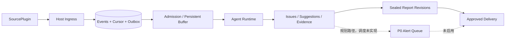

# 架构边界与当前实现

当前功能和验证汇总见 [项目状态](PROJECT-STATUS.md)；本页描述合入 PR #7/#8 后的 main。

## 包边界

`plugin-sdk → contracts`；`contract-validation → contracts + Ajv`。`contracts` 没有运行时或业务依赖；平台插件只通过 SDK 认识 Host。校验器单独成包，避免插件仅使用类型时引入校验器或平台实现。

构建使用 TypeScript project references 和 pnpm workspace 包导出，不通过跨包相对路径读取 `src`。`scripts/check-boundaries.mjs` 检查依赖声明及源码 import/export/require；CI 将阻止 contracts 引入依赖、SDK 导出运行时模块、Core 引入平台实现，以及 connectors 读取数据库或领域内部接口。此检查是工程规则，不是第三方插件安全沙箱。

M1 新增 `agent-core → ingress + feedback-buffer + job-queue + persistence`；`ingress/feedback-buffer → job-queue + persistence + contract-validation`。独立的 `job-queue` 使 buffer 和 Core 共用同一事务队列而不产生循环依赖。平台连接器仍仅依赖 SDK。

## 主链路

M1 实现 Ingress、SQLite Store、outbox/jobs、轻量 Admission、持久 Feedback Buffer 和定时扫描。M3 新增 `agent-workers → llm + memory + domain` 与独立 `issue-tracker → domain`。模型通过受限 AgentContext 形成结构化提案，领域服务校验后原子提交；GitHub Provider 不进入 Agent Core，模型不持有凭据或发送方法。

正式入口为 `pnpm start --config config/superagent.json`。应用层组装一个 M1Runtime，将同一 store、queue、memory 和 domain 注入 M3 与 M5。M1、M3、M5 的受管理循环独立等待外部 IO，模型请求不会阻塞报告调度。`worker:m1` 和 `worker:m3` 仅保留为调试入口，正式运行无需额外 Worker，也不应并发操作同库。

QQ 官方插件通过 SDK Host 入库，支持 WebSocket 和签名回调；独立 C2C Delivery 由 plugin-host 持久发送意图。指定真实用户群与验收群的普通消息已验证，不能推断其他群权限；无历史/编辑对账，coverage 仍为 partial。可信 Registry 还可加载 Discord、Steam Reviews（默认负评，可选 all）、独立评价评论，以及 Discussions 的 public/snapshot 模式；Discussions 默认仍为 unavailable。匿名公开页面采集与本地快照是不同验证范围，均不承诺完整历史。见 [Steam 运行说明](STEAM-PUBLIC-FEEDBACK.md)。

M5 新增 `reporting → domain + job-queue`，在独立 report 队列生成固定窗口和封存修订；`control-plane → reporting + domain` 为 Web 与 QQ 共享查询、鉴权、状态动作及关联纠错；`web-console → control-plane` 仅提供本机 HTTP。QQ Source 只调用注入的持久收件箱回调，实际查询和投递由 Host 异步执行。可信启动脚本组合平台插件，Core 不导入它们。GitHub 状态操作先远端确认再改变本地状态。P0 实时调度仍未安装。

M0 参考 SQL 回归继续保留。M1 集成测试另行通过真实文件数据库和子进程终止测试运行实际 TypeScript 实现，不能将其表述为真实 QQ/GitHub 联调。

应用插件管理器持有每个 start 任务，检查 Manifest/Schema/声明权限并注入独立绑定的 SourcePluginHostV1。阻塞式 start 自带 sync；QQ 的后台 start 返回后才串行 sync。短期有限退避耗尽后，可恢复故障进入长期低频恢复；明确永久配置/认证/权限错误停止该实例。连续确认健康默认 60 分钟可一次性恢复短期预算，判据按来源类型区分。旧 Host 失效、stop 和所有待恢复任务的取消由同一管理器负责，单插件故障不终止 Core。新公开 Steam 来源使用被动 probe，真实联网验证在绑定 Host 后开始；可信 Registry 初始化器可在启动前准备评论 checkpoint，并等待已持久化 Retry-After。插件不管理全局 Runtime 或业务策略。SQLite 应用 owner 防止多个正式入口操作同库，崩溃后只在确认原同机 PID 已消失时恢复。实现与限制见 [统一主程序](UNIFIED-APPLICATION.md)、[ADR 0015](ADR/0015-source-registry-and-recovery.md) 和 [ADR 0016](ADR/0016-stable-retry-budget-reset.md)。

## 身份与副作用

- 来源事件以 `(source, id)` 去重；内部证据使用 Host 生成的 `InternalEventId`。JSON Schema 无法判定某个字符串是否真正由 Host 生成。
- `commitBatch` 的事件、当前投影、事件会话路由、outbox 和 checkpoint 同事务提交；非法事件、身份冲突和数据库故障均整批回滚。M1 已完成这些故障注入测试。
- 外部请求先保存 `external_operations`；请求可能已到平台时，超时或崩溃进入 `unknown`。恢复流程以权威对账或人工审查为依据。
- 报告的稳定身份为 `report_series`，修订成员封存后只读；按钮绑定精确的 `reportId + revision`。实时 Issue 状态与报告快照分开呈现。

## 发布边界

仓库与 npm 包均保持私有。CI 文件只包含构建与测试，没有部署、包发布、对外发信或远端仓库创建步骤。平台凭据不属于契约 fixtures，不得加入 Git。
