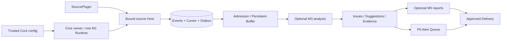

# 架构边界与当前实现

## 包边界

`plugin-sdk → contracts`；`contract-validation → contracts + Ajv`。`contracts` 没有运行时或业务依赖；平台插件只通过 SDK 认识 Host。校验器单独成包，避免插件仅使用类型时引入校验器或平台实现。

构建使用 TypeScript project references 和 pnpm workspace 包导出，不通过跨包相对路径读取 `src`。`scripts/check-boundaries.mjs` 检查依赖声明及源码 import/export/require；CI 将阻止 contracts 引入依赖、SDK 导出运行时模块、Core 引入平台实现，以及 connectors 读取数据库或领域内部接口。此检查是工程规则，不是第三方插件安全沙箱。

`pnpm start --config <core-config.json>` 是可信 Core 启动入口。Core 配置声明数据库、项目、来源 URI/平台/策略及插件清单；Core 创建一个 M1 Runtime 并应用精确来源注册表，已存在但不在清单中的来源策略不被改写。Core 不加载 `.env`。插件可读取授权密钥、提交绑定来源事件、读写获准的社区状态；它们不接收 Runtime/SQLite，也不决定来源策略。旧 `discord:bot`、`source:m4` 命令仅委托到 Core 组合。

M1 新增 `agent-core → ingress + feedback-buffer + job-queue + persistence`；`ingress/feedback-buffer → job-queue + persistence + contract-validation`。独立的 `job-queue` 使 buffer 和 Core 共用同一事务队列而不产生循环依赖。平台连接器仍仅依赖 SDK。

## 主链路

M1 实现 Ingress、SQLite Store、outbox/jobs、轻量 Admission、持久 Feedback Buffer 和定时扫描。M3 新增 `agent-workers → llm + memory + domain` 与独立 `issue-tracker → domain`。模型通过受限 AgentContext 形成结构化提案，领域服务校验后原子提交；GitHub Provider 不进入 Agent Core，模型不持有凭据或发送方法。

标准 Core 主循环先运行 `runtime.tick()`，再运行已配置的服务。M1 对标准来源执行 admission；`analysis.enabled` 默认为 false，设置为 true 且配置 `SA_LLM_BASE_URL`/`SA_LLM_MODEL` 后，Core 通过分析服务工厂在同一 Runtime 消费 triage 任务。`worker:m1`、`worker:m3` 保留兼容的独立进程入口。QQ 官方插件通过 SDK Host 入库，支持 WebSocket 和签名回调；独立 C2C Delivery 由 plugin-host 持久发送意图。真实群 @ 接入与开发者私聊已验证，群全量权限未证明。

来源策略只来自 Core 清单。`TrustedSourceRegistry` 精确应用清单中的绑定和策略；公共来源可用 `standard` 进入 admission，私密工单来源保持 `staff/archive_only`。Discord 社区插件只持有绑定后的 Source Host、只读私密事件读取能力和社区状态 facade。私密工单提交由 `CommunitySubmissions` 在一个事务中归档并初始化生命周期状态；Core 启动时恢复已归档但尚未完成初始化的提交，不重放平台 Interaction。

M5 的 `reporting → domain + job-queue` 在独立 report 队列生成固定窗口和封存修订；`control-plane → reporting + domain` 为 Web 与 QQ 共享查询、鉴权、状态动作及关联纠错；`web-console → control-plane` 提供本机 HTTP。Core 可选启用 M5 并借用同一 Runtime、Memory、Domain；M5 不创建或关闭 Core 的 Runtime。QQ Source 只调用注入的持久收件箱回调，实际查询和投递由 Host 异步执行。GitHub 状态操作先远端确认再改变本地状态。P0 实时调度仍未安装。

M0 参考 SQL 回归继续保留。M1 集成测试另行通过真实文件数据库和子进程终止测试运行实际 TypeScript 实现，不能将其表述为真实 QQ/GitHub 联调。

## 身份与副作用

- 来源事件以 `(source, id)` 去重；内部证据使用 Host 生成的 `InternalEventId`。JSON Schema 无法判定某个字符串是否真正由 Host 生成。
- `commitBatch` 的事件、当前投影、事件会话路由、outbox 和 checkpoint 同事务提交；非法事件、身份冲突和数据库故障均整批回滚。M1 已完成这些故障注入测试。
- 外部请求先保存 `external_operations`；请求可能已到平台时，超时或崩溃进入 `unknown`。恢复流程以权威对账或人工审查为依据。
- 报告的稳定身份为 `report_series`，修订成员封存后只读；按钮绑定精确的 `reportId + revision`。实时 Issue 状态与报告快照分开呈现。

## 发布边界

仓库与 npm 包均保持私有。CI 文件只包含构建与测试，没有部署、包发布、对外发信或远端仓库创建步骤。平台凭据不属于契约 fixtures，不得加入 Git。
