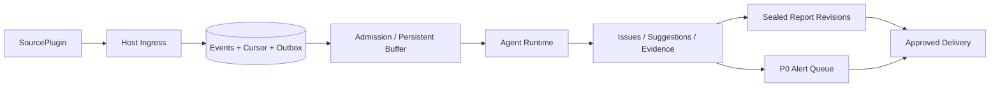

# 架构边界与当前实现

## M0 中存在的模块

`plugin-sdk → contracts`；`contract-validation → contracts + Ajv`。`contracts` 没有运行时或业务依赖；平台插件只通过 SDK 认识 Host。校验器单独成包，避免插件仅使用类型时引入校验器或平台实现。

构建使用 TypeScript project references 和 pnpm workspace 包导出，不通过跨包相对路径读取 `src`。`scripts/check-boundaries.mjs` 检查依赖声明及源码 import/export/require；CI 将阻止 contracts 引入依赖、SDK 导出运行时模块、Core 引入平台实现，以及 connectors 读取数据库或领域内部接口。此检查是工程规则，不是第三方插件安全沙箱。

## 后续主链路

此流程中的服务和数据库访问层属于 M1 及后续阶段，M0 没有启动它们。参考 SQL 仅用内存数据库验证，不能据此声称已经实现了事件事务、任务恢复或实际告警。

## 身份与副作用

- 来源事件以 `(source, id)` 去重；内部证据使用 Host 生成的 `InternalEventId`。JSON Schema 无法判定某个字符串是否真正由 Host 生成。
- `commitBatch` 的事件、outbox 和 checkpoint 必须同事务提交；失败整批回滚。M1 需实现并进行故障注入验证。
- 外部请求先保存 `external_operations`；请求可能已到平台时，超时或崩溃进入 `unknown`。恢复流程以权威对账或人工审查为依据。
- 报告的稳定身份为 `report_series`，修订成员封存后只读；按钮绑定精确的 `reportId + revision`。实时 Issue 状态与报告快照分开呈现。

## 发布边界

仓库与 npm 包均保持私有。CI 文件只包含构建与测试，没有部署、包发布、对外发信或远端仓库创建步骤。平台凭据不属于契约 fixtures，不得加入 Git。
